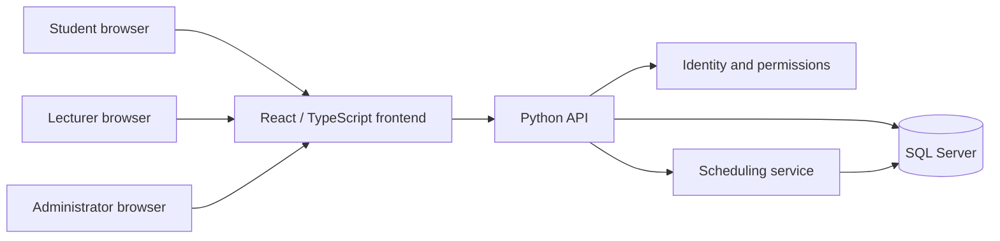

# ChronoCampus: current system and final project specification

Repository review date: 22 October 2026.

ChronoCampus is a university timetable and schedule management web application for students, lecturers, and academic administrators. Its final purpose is to turn the university's document-based timetables into a shared, persistent system for preparing, validating, publishing, and viewing schedules. The intended backend language is **Python**.

This document distinguishes **existing implementation**, **evidence from university documents**, and **proposed final requirements**. A visible interface or SQL definition does not establish that the corresponding feature works end to end.

## 1. Sources and limits of this review

| Source | What it establishes |
| --- | --- |
| [Frontend](../frontend/src/) and [package manifest](../frontend/package.json) | React/TypeScript/Vite interface, mock data, local interactions, and current data models. |
| [Database script](../db/ChronoCampus.sql) | SQL Server schema, constraints, triggers, views, scheduling procedures, and sample records. |
| [B1kurs1-1.doc](B1kurs1-1.doc), [B2kurs1-1.doc](B2kurs1-1.doc), [B3kurs1-1.doc](B3kurs1-1.doc), [B3kurs1.doc](B3kurs1.doc), [B4kurs1.doc](B4kurs1.doc) | Examples of the university's regular timetable grids, grouped by the document naming convention for course years. |
| [heraka-1-kurs.doc](heraka-1-kurs.doc), [heraka-2-kurs.doc](heraka-2-kurs.doc), [heraka-3kurs.doc](heraka-3kurs.doc), [heraka-4-kurs.doc](heraka-4-kurs.doc) | Examples associated with the university's հեռակա study form, including parenthesized group labels and an additional lesson block in one document. |

All nine Word files were extracted as Unicode text for inspection. They contain timetable tables rather than a written scheduling policy. Text extraction does not preserve all merged cells, horizontal divisions, or visual relationships. Consequently, the exact meaning of stacked entries, week divisions, and some subgroup labels needs visual verification against the originals. The documents also come from different saved revisions; they must not be combined into one supposedly current semester without confirmation.

The SQL was inspected as source, **not executed against SQL Server**. Its scheduling behavior and seed data still require database integration tests. The frontend build and a browser smoke test previously passed during environment setup; that validated the mock frontend, not a connected university system.

## 2. How the university timetables are structured

### 2.1 What is visible in the documents

The timetable is organized as a grid: student groups run through rows, while weekdays and paired lesson periods form the columns. The extracted weekday headings are Monday through Friday: Երկուշաբթի, Երեքշաբթի, Չորեքշաբթի, Հինգշաբթի, and Ուրբաթ. Regular grids use `1-2`, `3-4`, `5-6`, and `7-8`. The opening grid of `heraka-1-kurs.doc` also includes `9-10`; the other հեռակա examples should not automatically be assumed to use it everywhere.

A populated cell can contain a subject, lesson type, lecturer, and room. Examples from `B1kurs1-1.doc` include:

- `Ա և ԳՀ` / `Դաս` / `Խոսրովյան Հ.` / `12208`.
- `Հայոց լեզու` / `Գործ2` / `Հայրապետյան Լ.` / `9910`.
- `ԱԼ և Ծ` with `Լաբ3` and `Լաբ4`, two lecturer names, and rooms `5117` and `5119` in the extracted cell content.

These examples establish that the application must represent more than one generic class per group: practical and laboratory activities have numbered subdivisions, and a document cell may contain several activities. Exact lecturer-to-subgroup and room-to-subgroup pairings must be confirmed from the table layout before import.

| Document notation | Interpretation for the application | Evidence limit |
| --- | --- | --- |
| `Դաս` | Lecture. | Directly visible lesson label; corresponds to SQL `lecture`. |
| `Գործ`, `Գործ1`, `Գործ2`, `Գործ3` | Practical class, sometimes with a numbered subdivision. | The precise subdivision mapping needs confirmation. |
| `Լաբ`, `Լաբ3`, `Լաբ4` | Laboratory class, sometimes with a numbered subdivision. | Do not assume numbering has one universal meaning across faculties. |
| `ՄԹ440`, `ԻՏ447`, and similar labels | Real university group identifiers. | Preserve Unicode; do not replace them with demo identifiers such as `CS-1A`. |
| `ՀՄ345(1,2)` and `ՀՄ345(3)` | Distinct document labels associated with a shared base identifier. | Parentheses alone do not prove that these are the same hierarchy as SQL small/lab groups. |
| `2353ա`, `2127բ`, `12208` | Room identifiers can have Armenian suffixes and varying lengths. | Store room numbers as strings; do not infer buildings or floors solely from digits. |
| A number beside a group, such as `57` beside `ՄԹ440` | Appears to indicate group size. | Confirm the column meaning before treating it as authoritative capacity data. |

The abbreviation հեռակա describes a study form; it does not by itself establish that teaching happens online. The SQL calls it `remote`, but the documents still list physical rooms. Use a university-approved display label, such as “part-time / հեռակա,” rather than presenting all such lessons as video meetings. Students can study առկա (4 year duration) system and հեռակա (5 year dureation) system BOTH ON-SITE.

### 2.2 What the existing database adds

The schema expresses a more explicit scheduling model than the extracted Word text:

- Faculties contain departments; majors belong to faculties and distinguish `present` and `remote` study forms.
- Course groups contain small groups, which contain lab groups.
- Lectures target a course group; practical classes target a small group; laboratory and language-laboratory classes target a lab group.
- A schedule entry identifies its lecturer profile, subject and lesson type, room, weekday, block, week parity, semester number, and effective dates.
- Week parity is `every`, `numerator`, or `denominator`.
- The database permits weekdays 1–6, including Saturday, while the inspected document headings and frontend day type cover Monday–Friday.
- The `9-10` block is restricted by SQL triggers to `remote` study groups. This is an existing implementation rule, not proof of a university-wide policy.

The database seeds these clock times; the Word headings establish period labels, not these exact clock times:

| Period | Start | End | SQL restriction |
| --- | --- | --- | --- |
| 1-2 | 09:30 | 10:50 | General |
| 3-4 | 11:00 | 12:20 | General |
| 5-6 | 12:50 | 14:10 | General |
| 7-8 | 14:20 | 15:40 | General |
| 9-10 | 16:00 | 17:20 | `remote` study form only |

All seeded blocks are 80 minutes. Confirm the clock times and eligibility rules with the university before adopting them as final policy.

### 2.3 Proposed digital scheduling workflow

The documents show the result of scheduling, not the internal approval process. The following is the proposed workflow for ChronoCampus:

1. Configure the academic year, term dates, study forms, teaching days, lesson blocks, and numerator/denominator calendar anchor.
2. Register faculties, departments, majors, groups and subdivisions, lecturers, rooms, capacities, and equipment.
3. Enter teaching requirements: subject, lesson type, lecturer, audience, required frequency, and duration. Keep academic workload units explicit.
4. Record lecturer and room availability, required subject order, and preferences.
5. Create a draft timetable manually or generate candidate placements.
6. Validate every placement, show conflicts and unplaced requirements, and allow authorized corrections.
7. Review and publish a version for a defined academic period.
8. Show the same published data to students and lecturers. Record later changes with effective dates and an audit history.

## 3. What already exists

### 3.1 Frontend

The frontend is a substantial interactive prototype, built with React 18, TypeScript, Vite, Radix UI components, and existing CSS. It includes Armenian, English, and Russian interface text, theme switching, and layouts designed for different screen sizes. Translation coverage and accessibility still need a full acceptance review.

| Area | Existing behavior | Remaining work |
| --- | --- | --- |
| Login | Microsoft-style button, local login form, validation, simulated delays and responses. | Real authentication, verified identities, server-side roles, session handling. |
| Password recovery/change | Multi-step interface and mock responses. | Secure token delivery, expiration, password hashing, and persisted updates. |
| Student/lecturer timetable | Day, group, and week-parity filtering; lesson cards with subjects, lecturers, rooms, and times. | Query authenticated users' real schedules, including inherited subgroup lessons. |
| Notes | Create, edit, delete, categorize, and pin notes stored in browser local storage. | User-owned records in the database and authorization checks. |
### 3.2 Database

The SQL Server script contains considerably more than basic table definitions:

| Area | Existing SQL objects |
| --- | --- |
| Academic organization | `Faculty`, `Department`, `Major`, `CourseGroup`, `SmallGroup`, `LabGroup`. |
| Identity | `User`, `Role`, `UserRole`, `UserProfile`, `UserSession`, `PasswordResetToken`. |
| Teaching and facilities | `Subject`, `LessonType`, `LessonBlock`, `WeekParity`, `Building`, `Room`, `EquipmentType`, `RoomEquipment`, `SubjectEquipmentReq`. |
| Timetable and rules | `ScheduleEntry`, `SubjectConstraint`, lecturer/room availability, and lecturer preferences. |
| Generation | `SchedulingTask`, `SchedulingAttempt`, `sp_schedule_task`, `sp_generate_schedule`, and conflict/subject-constraint procedures. |
| Reporting | `vw_full_schedule`, `vw_lecturer_workload`, `vw_schedule_conflicts`, and an available-room function. |

Constraints and triggers attempt to enforce room and group types, capacity, equipment, parity conflicts, parent/subgroup overlaps, membership consistency, and study-form block restrictions. Subject rules include `BEFORE`, `NOT_SAME_DAY`, and `MIN_BLOCKS_GAP`.

The generation procedure processes tasks by priority, ranks candidate slots using lecturer preferences, attempts limited relocation of an existing entry, and retries contention failures. It records attempts and distinguishes structural failures from contention. This is an existing SQL scheduling approach; it is not evidence of a globally optimal or complete solver.

The script starts by dropping and recreating the database. It is a development bootstrap, not a safe production migration strategy. Sample accounts and scheduling records are demonstration data, not university imports.

### 3.3 Python backend

No Python backend, API routes, dependency manifest, database connection layer, or backend tests are present in the reviewed checkout. The Python backend is a required implementation stage. Existing SQL procedures do not replace the application's authentication, permissions, API, and transaction boundaries.

## 4. Important mismatches to resolve

| Topic | Current difference | Required final decision or change |
| --- | --- | --- |
| Week parity | Frontend uses `both`; SQL uses `every`. Documents lack an explicit parity legend in extracted text. | Define one API mapping and obtain the real calendar/parity rule. |
| Lesson types | UI models include `practice` and `mixed`; SQL uses `practical` and separate lesson types including `language_lab`. | Normalize types and split mixed teaching requirements into schedulable activities. |
| Roles | Some frontend models use `teacher`, others `lecturer`; SQL uses lecturer roles. | Use consistent identifiers and database-backed authorization. |
| Clock times | SQL ends the fifth block at 17:20; mock timetable data includes 15:50–17:10, and admin time slots differ again. | Read a single approved lesson-block catalog from the API. |
| Calendar | UI has semester objects with dates; SQL entries use a semester integer from 1 to 10. | Separate academic year/term identity from a student's curriculum semester. |
| Teaching days | UI types cover five days; SQL allows six. | Configure teaching days by the approved study form/term. |
| Group structure | UI mostly schedules flat groups; SQL supports nested subdivisions; documents contain numbered and parenthesized labels. | Confirm mappings and make parent/child attendance explicit. |
| Combined teaching | Mock lesson cards can list multiple groups; SQL entries target exactly one group level. | Model a shared lesson occurrence with multiple audiences, or define another collision-safe representation. |
| Workload | UI has credits/hours formulas; SQL tasks have `lessons_per_week` and `duration_blocks`. | Define credits, academic hours, minutes, and block frequency separately. The reviewed scheduling procedure does not consume those two task fields to create repeated or multi-block placements. |
| Capacity | Frontend treats overcapacity as a warning; SQL includes a rejecting capacity trigger. | Use a consistent hard constraint unless an explicit university exception policy exists. |
| History | Entries have effective dates, but many SQL queries treat only `effective_to IS NULL` as active; unique indexes are not scoped to date overlap. | Design and test date-aware validity and historical-version behavior. |
| Product records | UI has notes, feedback/comments, and semester/course-assignment concepts without corresponding complete SQL persistence. | Add reviewed migrations and API models for retained features. |

These findings come from source inspection. In particular, the SQL date and generation concerns need executable tests before being classified as fully diagnosed runtime defects.

## 5. What the final application should look like

### 5.1 Student experience

After signing in, the student lands on their timetable for the active academic term, current date, and correct week parity. The screen identifies their course group and subdivisions and includes all lessons they attend: full-group lectures plus their practical and lab sessions. A day view preserves the existing lesson cards; a week grid provides an overview similar to the university documents.

Every lesson shows the subject, lesson type, lecturer, room/building, period and clock time, and applicable week. Students can view permitted group schedules, maintain private notes, and submit feedback. Refreshing or using another device retains server-stored data. Unpublished draft changes are not visible.

### 5.2 Lecturer experience

Lecturers see lessons assigned to their authenticated profile across all relevant groups and subdivisions, with room and time details. They can switch between day/week views and review workload. If included in the agreed scope, they submit availability and preferences for administrator review; preferences do not silently alter the published timetable.

### 5.3 Administrator experience

The administration area retains the current users, subjects, groups/classrooms, scheduling, and feedback sections, backed by one shared API. It adds a usable academic-term configuration screen and a clear draft/review/publish workflow.

The scheduling workspace should contain:

- A filterable week grid for a group, lecturer, or room, showing both parity variants when needed.
- A list of teaching requirements and their scheduled/remaining workload.
- A lesson editor that selects actual catalog records and appropriate subgroup levels.
- Conflict explanations naming the resource, affected lesson, and overlapping time.
- Generation controls with progress/results, failed requirements, and actionable reasons.
- Review, publication, and change history for an explicitly selected academic term.

Drag-and-drop editing is optional; validated forms can satisfy the initial project. Automatic generation is a planned capability supported by the existing SQL design, but a reliable manually editable timetable should work first.

## 6. Proposed architecture and backend responsibilities

**Recommended starting point:** Python with FastAPI, validated request/response models, and a SQL Server-compatible database driver. This is a recommendation, not an existing framework choice; Django is also viable if required by the course. Keep SQL Server unless the team deliberately approves and migrates the SQL Server-specific schema and procedures.

The Python API should own authentication, role checks, input validation, transactions, user-scoped reads/writes, and domain errors. Initially it can call tested SQL scheduling procedures through a scheduling service. Do not implement conflicting scheduling rules independently in React, Python, and SQL. Decide which layer owns each rule and test that all entry points enforce it.

Suggested API groups, to be finalized during implementation:

| API area | Responsibilities |
| --- | --- |
| `/auth`, `/me` | Login/logout, identity, password reset/change, sessions, and approved Microsoft integration. |
| `/academic-terms`, `/lesson-blocks` | Calendar, parity anchor, teaching days, canonical periods. |
| `/faculties`, `/departments`, `/majors`, `/groups` | Academic structure and nested student audiences. |
| `/users`, `/lecturers`, `/subjects`, `/rooms` | Authorized catalog management, memberships, capacities, and equipment. |
| `/teaching-requirements`, `/availability`, `/preferences` | Scheduling inputs and workload requirements. |
| `/schedules`, `/scheduling-runs` | Draft placements, validation, generation outcomes, versions, and publication. |
| `/me/timetable`, `/me/notes`, `/feedback` | Personal timetable, private notes, and feedback lifecycle. |

Return stable IDs and consistent enums, with display names alongside them where useful. Use authenticated membership for personal schedules and notes; never trust a client-supplied role, email pattern, or profile ID as authorization. Store password hashes and protected reset/session token representations; implement expiry, revocation, and safe reset delivery. Real Microsoft login requires an approved university identity configuration, not the existing random mock response.

## 7. Core scheduling rules and acceptance checks

The final implementation should demonstrate the following with backend/database integration tests:

1. The same lecturer or room cannot be booked for overlapping teaching time in overlapping dates and parity.
2. An `every` lesson conflicts with either parity; numerator and denominator lessons can share a slot when their actual dates do not overlap.
3. A full-group lecture blocks lessons for its contained subgroups. Distinct subgroups can meet concurrently when their actual student memberships are disjoint.
4. Room capacity, room type, required equipment, lecturer availability, and room availability are enforced consistently for manual and generated placements.
5. Study-form restrictions and subject-order/gap rules follow confirmed university policy, including boundary cases across days and weeks.
6. Multiple weekly occurrences and multi-block lessons fulfill the requested workload without hidden omissions or collisions.
7. Concurrent administrative changes cannot produce double bookings; a rejected write leaves no partial schedule.
8. Changes to one term do not affect another academic year or unrelated term.
9. Publishing makes the reviewed timetable visible to the correct students and lecturers; drafts remain restricted.
10. Notes and account actions are private to the authorized user, and saved data survives reloads and backend restarts.

For a representative demonstration, transcribe one small, manually verified selection from a Word document into structured records. Include a lecture, a practical or lab subdivision, and real Unicode room/group identifiers. Compare the resulting grid with the original, then demonstrate one rejected room conflict and one successful correction. Add parity examples only after the original visual notation is confirmed.

## 8. Implementation order

| Stage | Deliverable | Completion evidence |
| --- | --- | --- |
| 1. Confirm the domain | Approved glossary, period catalog, group hierarchy, term/parity rules, and one verified document sample. | The sample can be represented without guessing or losing audience information. |
| 2. Establish backend and persistence | Python API, SQL Server development configuration, migrations, real accounts, permissions, and catalogs. | Authenticated CRUD and authorization tests pass; data persists. |
| 3. Deliver the core timetable | Teaching requirements, manual scheduling, server-side validation, personal timetable queries, and connected React screens. | Admin changes appear in the correct user views using one database. |
| 4. Review and publication | Term-scoped drafts, publish operation, date-aware changes, and audit trail. | Unpublished edits remain private and published versions are reproducible. |
| 5. Validate generation | Tested SQL scheduling service or a reviewed replacement, workload handling, and useful failure reporting. | Feasible examples are placed correctly; infeasible examples explain what remains unscheduled. |
| 6. Complete supporting features | Persisted notes/feedback, translation review, accessibility, responsive checks, and deployment documentation. | End-to-end role-based demonstrations pass on a clean installation. |

PDF/print export resembling the official grid, calendar export, notifications, and automated Word import are useful extensions. They should be scoped separately unless the course requires them. Word import should include a preview and human review because table layout and abbreviations make automatic interpretation ambiguous.

THE DATABASE ALMOST HAS THE UNI STRUCTURE!

## 9. Questions the files do not answer

- Which document revision and academic year should be treated as the authoritative import source?
- How are numerator/denominator weeks anchored, and how are holidays and exceptional teaching days handled?
- What precisely do the numbered practical/lab labels, parenthesized group suffixes, and adjacent numeric column mean?
- Which lessons combine multiple course groups or use several lecturers/rooms simultaneously?
- Are Saturday teaching and the fifth block allowed for each study form and term?
- Are room-type and capacity rules absolute, or can approved exceptions be recorded?
- What teaching-hour units, weekly repetition, and multi-block duration rules does the curriculum require?
- Who prepares, approves, and publishes schedules, and should those be separate permissions?
- Will the university provide Microsoft identity access, and what local-account fallback is allowed?
- Must automatic generation, exports, or notifications be included in the assessed final submission?

These questions should refine implementation; they do not prevent building the Python API, shared catalogs, and manually validated timetable workflow.

## 10. Definition of a finished project

ChronoCampus is complete when an authorized administrator can prepare and publish a university-representative timetable, the system prevents invalid bookings, and students and lecturers see their correct schedules from the same persistent database. The deliverable includes the React frontend, Python backend, SQL Server migrations and sample dataset, documented configuration/startup steps, and meaningful integration/end-to-end tests. Existing mock screens should be replaced or explicitly isolated as demo mode, with real identities and data used for the assessed end-to-end workflow.