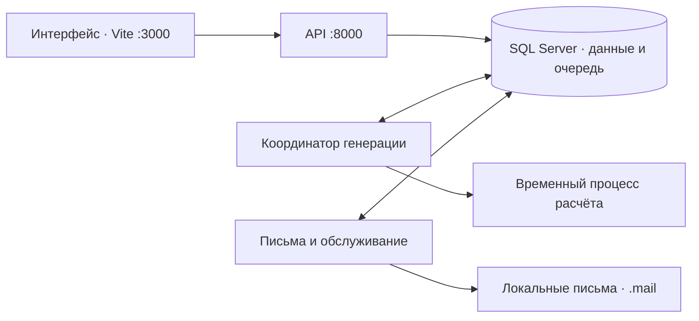

# Локальная архитектура и запуск

Система работает на вашем Windows-компьютере с уже установленным SQL Server. Сервер в облаке, Redis и Docker для запуска не нужны.



Постоянно работают API, координатор, обработчик писем и Vite. Небольшой управляющий процесс следит за этой группой. Во время генерации появляется отдельный процесс расчёта; одновременно допускается один расчёт. Пулы SQL ограничены: до пяти соединений API, трёх у координатора и двух у обработчика писем, без неограниченного overflow. Windows может показывать дополнительный процесс перенаправления Python из виртуального окружения — это не второй worker.

## Первичная подготовка

Установите зависимости и настройте `backend/.env` по README. Перед обновлением существующей базы остановите старые процессы и дождитесь завершения старых генераций. Сделайте нативную резервную копию SQL Server, проверьте её через `RESTORE VERIFYONLY` и сначала испытайте миграцию на восстановленной копии. Миграция `0004_jobs` добавляет таблицы очереди и сохраняет старую историю; она откажется работать при незавершённых старых генерациях. Запуск приложения не выполняет миграции автоматически.

Из корня проекта:

```powershell
Push-Location backend
.venv/Scripts/python.exe -m alembic upgrade head
Pop-Location
powershell -ExecutionPolicy Bypass -File scripts/local.ps1 init-mail-key
powershell -ExecutionPolicy Bypass -File scripts/local.ps1 start
```

`init-mail-key` создаёт ключ шифрования очереди писем в игнорируемом `backend/.secrets/mail-keys.json`. Повторная команда сохраняет существующий ключ. Она не выводит его в консоль. Сохраняйте файл вместе с защищённой резервной копией конфигурации; без него ожидающие письма нельзя расшифровать. Для `MAIL_MODE=file` письма появляются в `backend/.mail`, отправки в интернет нет.

Откройте [приложение](http://localhost:3000). Управление:

```powershell
powershell -ExecutionPolicy Bypass -File scripts/local.ps1 status
powershell -ExecutionPolicy Bypass -File scripts/local.ps1 stop
powershell -ExecutionPolicy Bypass -File scripts/local.ps1 start
```

Повторный `start` возвращает состояние запущенной группы. Занятые чужим процессом порты 3000/8000 вызывают понятную ошибку; скрипт не завершает чужие процессы. Для остановки проверяются идентичность управляющего процесса и время его создания, а не только PID. Частичный неудачный запуск закрывает только созданную им группу. Состояние и ограниченные журналы консоли находятся в `.runtime/`, структурированные события — в `backend/.logs/`.

## Задания и восстановление

Кнопка генерации сохраняет задание в SQL. Потеря HTTP-ответа и повтор запроса с тем же ключом не создают второй запуск. По умолчанию в очереди допускаются четыре активных задания. Снимок входных данных создаётся при первой попытке выполнения, а не при нажатии кнопки.

Worker регулярно подтверждает владение заданием. После аварии просроченная аренда позволяет восстановить задание: максимум три попытки, ожидание 5/20 секунд с небольшим разбросом. Аренда по умолчанию 60 секунд, heartbeat — 10 секунд. Старый процесс не может сохранить результат после потери владения. Изменение данных или черновика делает старый снимок непригодным: такой результат не перезаписывает новые правки. Ошибки входных данных и отклонённые результаты требуют исправления, бесконечных повторов нет.

В «Генераторе» доступны отмена, ожидание повторной попытки и история попыток. Отмена выполняющегося задания сначала останавливает расчёт, затем освобождает черновик. При аварийной остановке всего компьютера освобождение произойдёт после истечения аренды и запуска worker. API можно перезапустить отдельно без сброса работающей генерации; штатный `stop` останавливает всю локальную группу.

Письма хранятся зашифрованными до доставки. Worker проверяет срок действия, использование токена и активность аккаунта. После SMTP-отправки и аварии до фиксации возможен повтор того же письма; ссылка остаётся одноразовой. Раз в минуту обработчик выполняет ограниченную очистку истёкших сессий, ограничителей запросов и reset-токенов. История расписаний, заданий и аудит не удаляются автоматически.

Ротация ключа сохраняет старые ключи для ожидающих писем:

```powershell
powershell -ExecutionPolicy Bypass -File scripts/local.ps1 rotate-mail-key
```

Не удаляйте старые ключи вручную, пока есть письма, зашифрованные ими. Потеря ключа не восстанавливается из базы.

## Где смотреть проблемы

«Диагностика» показывает очередь, возраст heartbeat, worker и его текущее задание. История попыток хранится в SQL и переживает перезапуск. События в памяти относятся к текущему API; у каждого процесса отдельный файл `events.jsonl-<instance_id>` с ротацией. События содержат роль и экземпляр процесса, без токенов, содержимого письма и снимков генерации. Подробности — в [руководстве диагностики](observability.md).

Если `start` сообщает `migrations_required`, выполните проверенное обновление схемы. Если `mail_key_missing_or_invalid`, проверьте настройки и существующий ключ, не заменяйте его пустым файлом. После сбоя worker группа останавливается; изучите `.runtime/*.stderr.log`, затем снова запустите её. Сохранённые задания подхватит новая группа.

Чтение расписания ограничено датами и страницами, поэтому большой семестр не выгружается целиком. Дополнительный кеш пока не нужен: запросы используют SQL-фильтры и соединения, а повторная проверка прав защищает от выдачи данных после изменения группы или сессии. Развёртывание на сервере и полноценная эксплуатация нескольких машин требуют отдельного этапа проверки.
